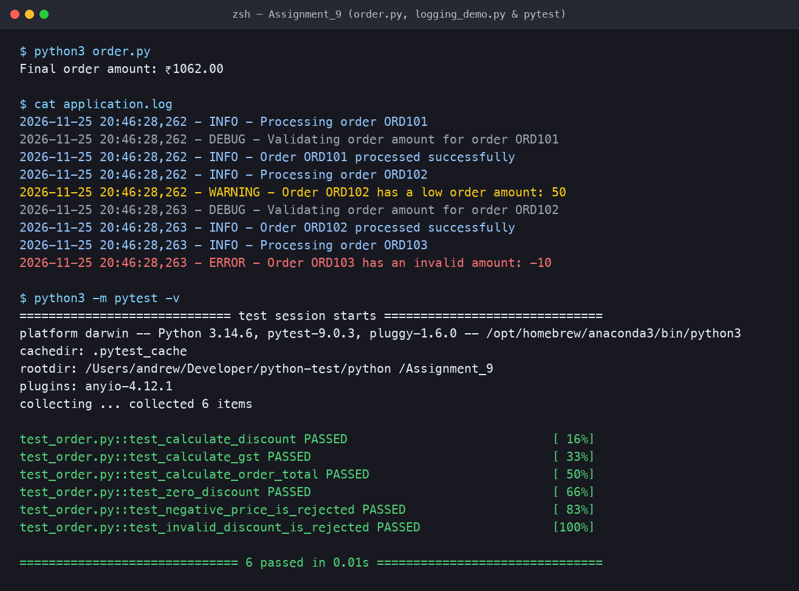
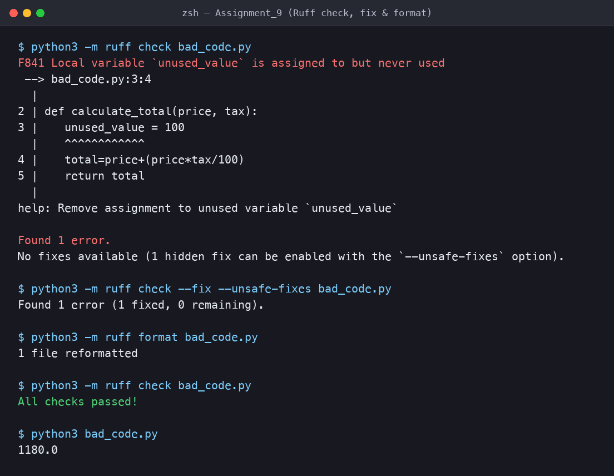
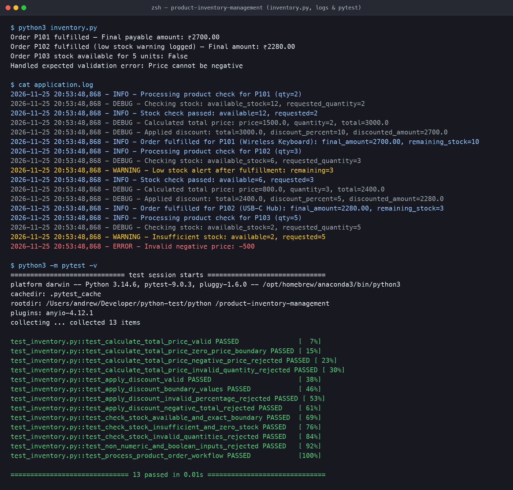
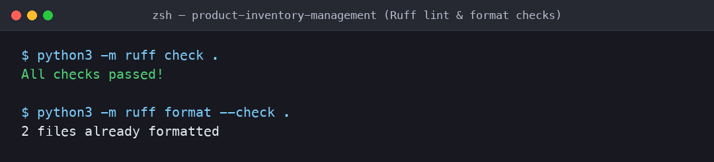

# MCA Python Programming — Assignment 9 and Assignment 10

This repository contains both **Assignment 9 (Unit Testing, Logging and Code Quality)** and **Assignment 10 (Product Inventory Management System)**, complete with source code, `pytest` unit tests, `application.log` outputs, `Ruff` code-quality verification, and execution screenshots.

---

## Repository Structure

```text
Assignment-9-and-10/
├── Assignment_9/                         # Assignment 9 (Practical 10 Implementation)
│   ├── order.py                          # Discount, GST, and order total calculations
│   ├── test_order.py                     # Pytest test suite (6 test cases)
│   ├── logging_demo.py                   # DEBUG, INFO, WARNING & ERROR logging demo
│   ├── bad_code.py                       # Code cleaned & formatted with Ruff
│   └── application.log                   # Generated order processing log
├── product-inventory-management/         # Assignment 10 (Product Inventory System)
│   ├── inventory.py                      # Pricing, discounts, stock checks & logging
│   ├── test_inventory.py                 # Pytest test suite (13 test cases)
│   ├── README.md                         # Dedicated Assignment 10 guide
│   ├── .gitignore                        # Ignores .venv and Python/test caches
│   └── application.log                   # Generated inventory operations log
├── screenshots/                          # Execution output screenshots
│   ├── assignment9_pytest_and_logs.png
│   ├── assignment9_ruff_workflow.png
│   ├── assignment10_pytest_and_logs.png
│   └── assignment10_ruff_checks.png
└── README.md
```

---

## macOS Setup & Installation

```bash
# Clone the repository
git clone https://github.com/Andrew93541/Assignment-9-and-10.git
cd Assignment-9-and-10

# Create and activate a virtual environment (.venv is git-ignored)
python3 -m venv .venv
source .venv/bin/activate

# Install pytest and Ruff
python3 -m pip install --upgrade pip
python3 -m pip install pytest ruff
```

---

## Assignment 9: Unit Testing, Logging and Code Quality (`Assignment_9/`)

### Run Commands
```bash
cd Assignment_9
python3 order.py
python3 logging_demo.py
cat application.log
python3 -m pytest -v
python3 -m ruff check bad_code.py
```

### Assignment 9 Output Screenshots

#### 1. Order Calculation, Application Logging & Pytest Execution


#### 2. Ruff Linting, Auto-Fix & Formatting Workflow (`bad_code.py`)


---

## Assignment 10: Product Inventory Management System (`product-inventory-management/`)

### Features Implemented
- **`calculate_total_price(price, quantity)`** — Computes total product cost and validates non-negative numeric prices and positive integer quantities.
- **`apply_discount(total, discount_percent)`** — Calculates discounted total and validates `0..100%` discount range.
- **`check_stock(available_stock, requested_quantity)`** — Checks stock availability, logs low-stock and insufficient-stock warnings, and validates integer quantities.
- **Exception Handling & Logging** — Raises `ValueError`, `TypeError`, and `KeyError` on invalid inputs, handles validation exceptions cleanly, and records `DEBUG`, `INFO`, `WARNING`, and `ERROR` logs in `application.log`.

### Run Commands
```bash
cd product-inventory-management
python3 inventory.py
cat application.log
python3 -m pytest -v
python3 -m ruff check .
python3 -m ruff format --check .
```

### Assignment 10 Output Screenshots

#### 1. Inventory Execution, Application Log & Pytest Suite (`13 passed`)


#### 2. Ruff Linting & Formatting Verification

