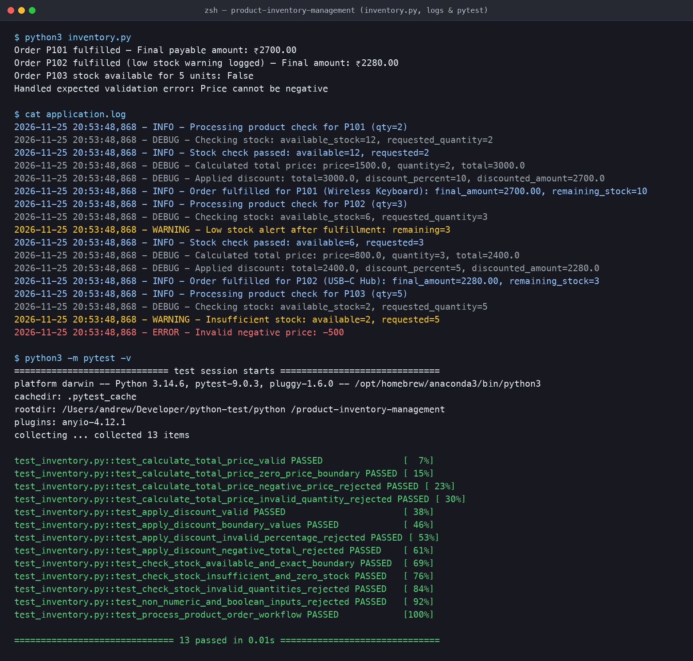
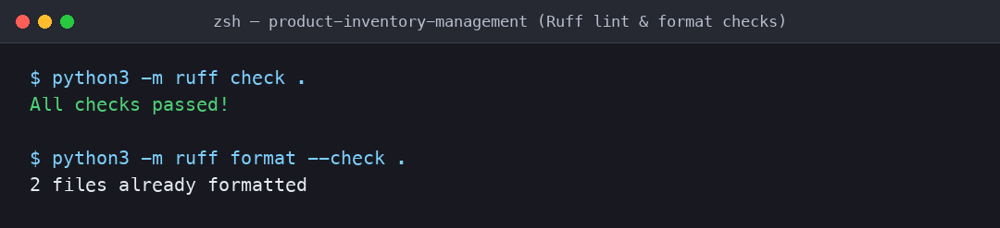

# Product Inventory Management System (Assignment 10)

## Project Description

A Python-based **Product Inventory Management System** implementing product price calculation, discount application, stock availability checks, input validation, exception handling, multi-level file logging (`application.log`), automated unit testing (`pytest`), and code quality verification (`ruff`).

---

## Features Implemented

- **`calculate_total_price(price, quantity)`** — Computes total product cost and validates non-negative numeric prices and positive integer quantities.
- **`apply_discount(total, discount_percent)`** — Calculates final payable amount after applying a validated `0..100%` discount.
- **`check_stock(available_stock, requested_quantity)`** — Checks whether requested stock can be fulfilled, logs low-stock (`< 5` remaining) and insufficient-stock warnings, and validates integer quantities.
- **`process_product_order(...)`** — Coordinates catalog lookup, stock verification, total & discount calculation, and stock deduction.
- **Exception Handling** — Raises `ValueError`, `TypeError`, and `KeyError` for invalid inputs and demonstrates `try...except` recovery.
- **Structured Logging (`application.log`)** — Logs `DEBUG`, `INFO`, `WARNING`, and `ERROR` events using Python's `logging` module.
- **Unit Testing (`test_inventory.py`)** — 13 `pytest` test cases covering valid inputs, boundary values, and invalid inputs.
- **Code Quality (`Ruff`)** — Verified clean under `ruff check .` and `ruff format --check .`.

---

## macOS Setup & Installation Commands

```bash
# 1. Navigate to the project folder
cd product-inventory-management

# 2. Create and activate a macOS virtual environment (.venv is git-ignored)
python3 -m venv .venv
source .venv/bin/activate

# 3. Install pytest and ruff
python3 -m pip install --upgrade pip
python3 -m pip install pytest ruff
```

---

## Execution Instructions

Run the Product Inventory Management System and inspect the generated log file:

```bash
python3 inventory.py
cat application.log
```

---

## Testing & Code Quality Instructions

```bash
# Run pytest unit tests
python3 -m pytest -v

# Run Ruff lint and formatting checks
python3 -m ruff check .
python3 -m ruff format --check .
```

---

## Execution Screenshots

### Program Output, Logging & Pytest Execution


### Ruff Linting & Formatting Checks

